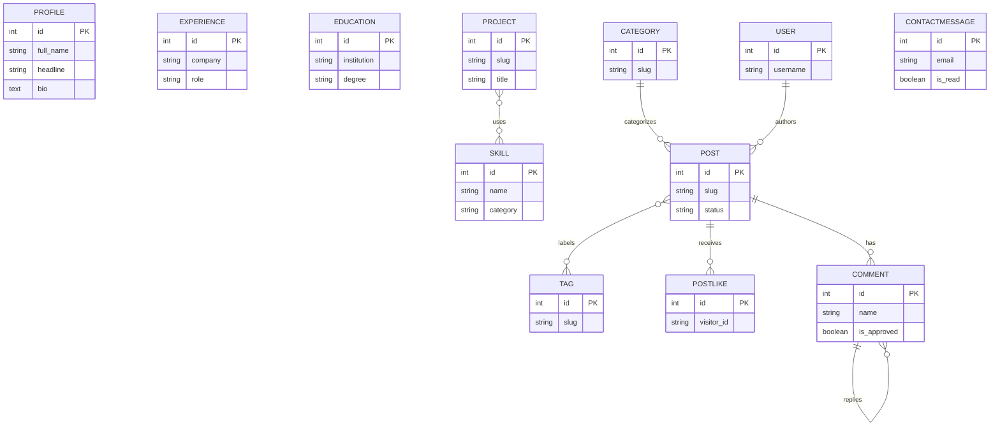

# Portfolio Blog API

A Django REST Framework API that powers the companion portfolio website, blog, and private owner dashboard.

## Tech stack

- Python 3.10+
- Django 5.2
- Django REST Framework
- SimpleJWT with refresh-token rotation and blacklisting
- django-filter, django-cors-headers, Pillow
- SQLite for local development

## Features

- Public profile, skills, experience, education, projects, categories, tags, published posts, and approved comments.
- Owner-only JWT authentication and content-management API; no public registration.
- Visitor post likes, moderated comments, contact inbox, and dashboard statistics.
- Search, filters, ordering, and paginated list endpoints.
- Markdown blog content rendered by the frontend without raw HTML.
- Upload validation for profile/project/post images and PDF résumés.
- Post view-count cooldown, request-timing logs, Django admin, and Postman collection.

## Local setup

Clone the repository, then run these commands from the repository root in PowerShell:

```powershell
git clone https://github.com/marufnoor81-droid/portfolio-backend.git
cd portfolio-backend\portfolio-backend
python -m venv .venv
.\.venv\Scripts\Activate.ps1
python -m pip install -r requirements.txt
Copy-Item .env.example .env
python manage.py migrate
python manage.py createsuperuser
python manage.py runserver
```

The project files are in the repository's `portfolio-backend/` subfolder. The API runs at `http://127.0.0.1:8000/api/`, and Django admin runs at `http://127.0.0.1:8000/admin/`. Start the frontend separately and configure its API URL to this backend.

Run checks with `python manage.py check` and `python manage.py test`.

## Environment variables

Copy `.env.example` to `.env` for local development. Replace development values before deployment.

| Variable | Purpose | Local example |
| --- | --- | --- |
| `SECRET_KEY` | Django signing and cryptographic secret | `replace-me-with-a-long-random-secret` |
| `DEBUG` | Enables development-only behavior | `True` |
| `ALLOWED_HOSTS` | Comma-separated backend hostnames | `127.0.0.1,localhost` |
| `CORS_ALLOWED_ORIGINS` | Exact frontend origins allowed to call the API | `http://localhost:5173` |
| `DB_NAME` | SQLite database path | `db.sqlite3` |

Never commit `.env`, credentials, `db.sqlite3`, or uploaded `media/`. Production requires `DEBUG=False`, a strong secret, HTTPS, explicit hosts/CORS origins, a persistent database, and persistent media storage.

## API endpoints

All routes are prefixed with `/api`. “Owner” means an authenticated Django superuser. Collection/detail writes accept the applicable JSON or multipart payload; list endpoints are paginated.

| Resource | Method and endpoint | Access |
| --- | --- | --- |
| Login | `POST /auth/login/` | Public |
| Refresh JWT | `POST /auth/refresh/` | Public; valid refresh token required |
| Logout | `POST /auth/logout/` | Owner |
| Current owner | `GET /auth/me/` | Owner |
| Change password | `POST /auth/change-password/` | Owner |
| Profile | `GET /profile/` | Public |
| Profile | `PATCH /profile/` | Owner |
| Skills | `GET /skills/`, `GET /skills/{id}/` | Public |
| Skills | `POST /skills/`, `PUT/PATCH/DELETE /skills/{id}/` | Owner |
| Experience | `GET /experiences/`, `GET /experiences/{id}/` | Public |
| Experience | `POST /experiences/`, `PUT/PATCH/DELETE /experiences/{id}/` | Owner |
| Education | `GET /education/`, `GET /education/{id}/` | Public |
| Education | `POST /education/`, `PUT/PATCH/DELETE /education/{id}/` | Owner |
| Projects | `GET /projects/`, `GET /projects/{slug}/` | Public |
| Projects | `POST /projects/`, `PUT/PATCH/DELETE /projects/{slug}/` | Owner |
| Categories | `GET /categories/`, `GET /categories/{id}/` | Public |
| Categories | `POST /categories/`, `PUT/PATCH/DELETE /categories/{id}/` | Owner |
| Tags | `GET /tags/`, `GET /tags/{id}/` | Public |
| Tags | `POST /tags/`, `PUT/PATCH/DELETE /tags/{id}/` | Owner |
| Posts | `GET /posts/`, `GET /posts/{slug}/` | Public; published posts only |
| Posts | `POST /posts/`, `PUT/PATCH/DELETE /posts/{slug}/` | Owner |
| Post likes | `POST /posts/{slug}/like/` | Visitor; requires `X-Visitor-Id` |
| Post comments | `GET /posts/{slug}/comments/` | Public; approved comments only |
| Post comments | `POST /posts/{slug}/comments/` | Visitor; new comments await approval |
| Comment moderation | `GET /comments/`, `GET /comments/{id}/` | Owner |
| Comment moderation | `PATCH/DELETE /comments/{id}/` | Owner |
| Contact messages | `POST /contact/` | Visitor |
| Contact inbox | `GET /contact/`, `GET /contact/{id}/` | Owner |
| Contact inbox | `PATCH/DELETE /contact/{id}/` | Owner |
| Dashboard metrics | `GET /dashboard/stats/` | Owner |

`HEAD` and `OPTIONS` are also available where provided by DRF. There is deliberately no registration endpoint. Public responses never expose commenter email addresses.

## Data model overview



`Profile` is a singleton. `Project` relates to `Skill` through a many-to-many field. A `Post` has one optional `Category`, many `Tag`s, and an owner author. `PostLike` is unique per `(post, visitor_id)`. `Comment` belongs to a post and may have one parent comment. `ContactMessage` is private inbox data.

## View counter and permissions

- On a post detail request, the frontend sends a persistent random `X-Visitor-Id`. The API hashes it with SHA-256 and builds a cache key from the post ID and hash.
- `cache.add` allows one increment per visitor/post per 24-hour cooldown. When it succeeds, an atomic Django `F()` update increments `views_count`, avoiding lost updates under concurrent requests.
- `IsOwnerOrReadOnly` allows safe read methods to everyone and permits writes only for an authenticated Django superuser.
- `IsOwner` restricts private actions such as dashboard stats, comment moderation, inbox access, and authenticated session management to an authenticated superuser.

## Throttle rates

| Scope | Limit |
| --- | --- |
| Anonymous API requests | 20 per minute |
| Comment creation | 5 per hour |
| Contact submissions | 3 per hour |
| Like toggles | 30 per minute |

## Related links

- [Frontend repository](https://github.com/marufnoor81-droid/portfolio-frontend)
- [Postman collection in this repository](./postman_collection.json) ([view on GitHub](https://github.com/marufnoor81-droid/portfolio-backend/blob/main/portfolio-backend/postman_collection.json))
- Live API: **Not deployed yet.**
